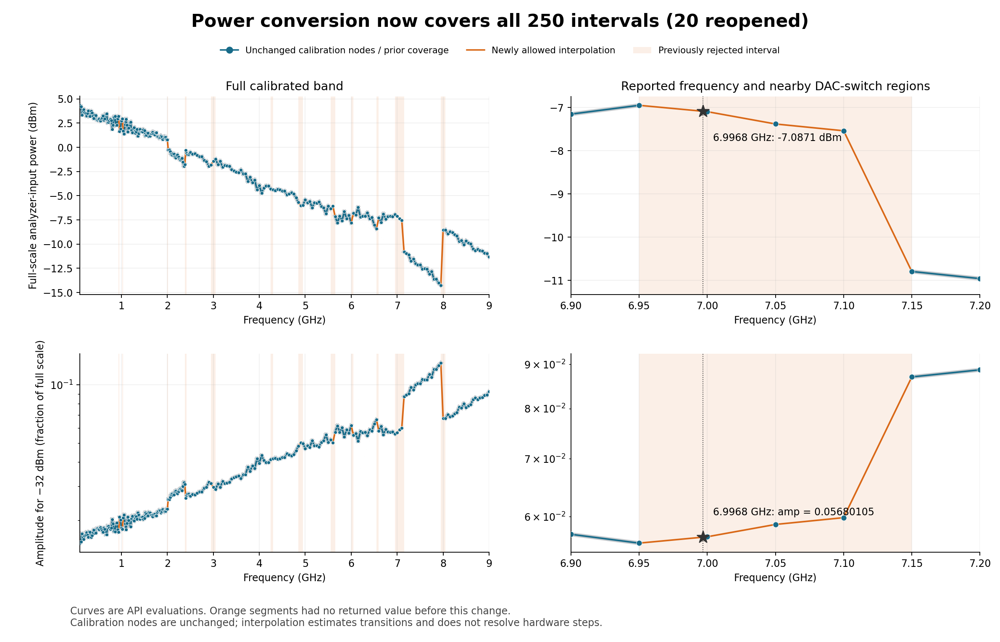
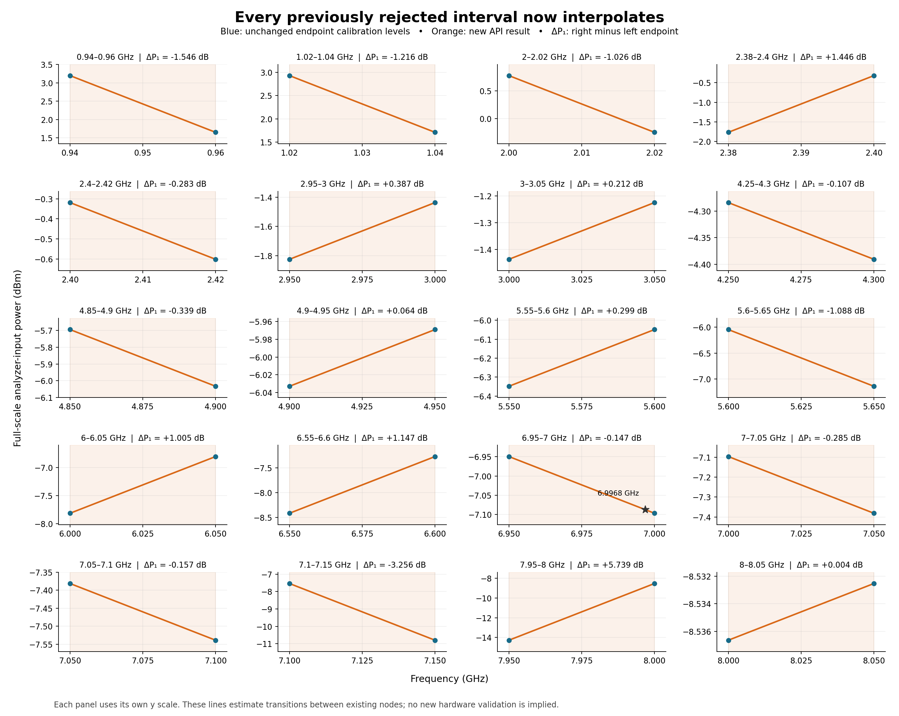

# Filter-offset-corrected power calibration — v4, 30 October 2026

**0.1–2.1 GHz is calculated by filter offset.** Both conversion functions now use the
original low-band amplitude curves after correction, preserving their supported measured
shape. These are estimates of unfiltered analyzer-input power, not direct unfiltered sweeps.
Release v3 replaced the prior v2 single-amplitude-anchor implementation in PR #79. Release v4
keeps those calibration curves and enables interpolation throughout 0.1–9 GHz, including all
20 previously rejected intervals. No new hardware measurements were taken for this revision.

## Correction calculation

The Oct 2 low-band sweep measured 101 frequencies (100–2100 MHz, 20 MHz spacing), with 50
logarithmic amplitude settings from 0.001 to 1 at each frequency, through TWO cascaded
Mini-Circuits VLFX-2500+ low-pass filters. On Oct 12, all 101 frequencies were measured without
filters at amplitude 0.1. These datasets now define:

```
offset_dB(f) = P_unfiltered(f, 0.1) - P_filtered_interpolated(f, 0.1)
P_corrected(f, A) = P_filtered(f, A) + offset_dB(f)
```

The original 50-point amplitude grid does not include 0.1 exactly. Interpolate filtered dBm
linearly in log amplitude between its two adjacent samples; both bracket samples must be
unflagged. There is no fit to the separate amplitude-check observations and no averaging
across different frequencies. Every original point receives the same frequency-specific
offset, preserving all point-to-point amplitude differences.

The correction assumes amplitude-independent loss and sufficiently comparable source/cable
configurations between sessions. It includes possible path changes and drift, not only the
filter's insertion loss. Offsets range from −0.2950 to +2.6642 dB. Negative values at 140,
880 and 960 MHz are retained and flagged rather than forced positive; they cannot be read
as evidence of passive-filter gain. The controlled same-day filter-pair comparisons at five
frequencies are preserved separately for context. They were not substituted for the 101
per-frequency anchors. No main-tone correction is used to reconstruct suppressed spurs/noise.

## Source selection and runtime behavior

- Corrected low: 101 nodes, 5,050 original filtered observations, including 2.1 GHz.
- Direct gap: 19 nodes at 2.12–2.48 GHz, 950 observations.
- Direct high: 131 nodes at 2.5–9 GHz, 13,100 observations.

The total is 251 nodes and 19,100 selected source rows. The full direct 2.1 GHz gap sweep
remains an independent overlap check. The direct gap 2.5 GHz endpoint remains in the source
table, but the original high-band 2.5 GHz model is retained.

In the low band, the forward function interpolates corrected dBm against log amplitude and
the inverse solves this same piecewise curve. Above 2.1 GHz the previous direct-sweep
P1+20*log10(abs(A)) model is preserved. At permitted off-grid frequencies the two neighboring
curves are blended at the requested amplitude; the inverse solves that blended curve.

Quality screening retains the earlier acquisition flags and 0.5 dB absolute residual rule
against a high-amplitude 20 dB/decade reference. That reference is used to choose a reliable
lower amplitude bound; it does NOT replace the corrected low curve. All supported corrected
curves must be strictly monotonic for a unique inverse. All 5,050 corrected samples remain
in the CSV and NPZ, including weak/flagged samples. Below the supported bound, both functions
warn and use a 20 dB/decade extension from that bound, instead of inverting noisy/nonmonotonic
samples. Corrected-data support is conditional on the correction assumptions, not direct
unfiltered verification at all amplitudes.

Both functions emit FilterOffsetWarning (a CalibrationWarning subtype) when the query uses
the corrected low band, including interpolation involving its endpoint. Outside amplitude
support there is additionally a CalibrationWarning. verified_amp_range returns conditional
source-quality bounds; min_verified_amp retains its older name for compatibility. Public
conversion names and GHz inputs are unchanged; amp_to_power_dbm_hz takes Hz. Amplitude is
dimensionless voltage fraction, not current in amperes. Above-full-scale requests fail.

## Validation

The software suite covers the exact original-plus-offset calculation for every point,
all offsets' interpolation brackets, retained flags/negative offsets, preservation of
supported curve samples and midpoint shape, inverse behavior between samples and frequencies,
weak-tail handling, corrupt/obsolete assets, unchanged direct gap/high calculations and
rebuilding every asset array. Agreement with corrected source knots is by construction and
is not independent accuracy evidence.

Independent Oct 12 observations, excluded from curve/offset construction:

| Check | Points | Maximum absolute discrepancy |
| --- | ---: | ---: |
| Five amplitudes at 0.1, 1 and 2.1 GHz | 15 | 0.0392 dB |
| High-band checks at 2.5, 5.2 and 9 GHz | 9 | 0.1660 dB |
| Direct 2.1 GHz gap overlap, unflagged points above corrected support floor | 42 | 0.1639 dB |

These checks support the correction at the tested locations but do not establish full-band
accuracy, amplitude-independent loss everywhere, or universal ±0.04 dB performance. The
101 anchors match by construction and are not counted as independent validation. Withheld
frequency diagnostics are also in power_calibration_validation.json; they test wider spacing
than ordinary interpolation and are not accuracy bounds.

## Frequency interpolation and configuration

All 250 adjacent intervals across 0.1–9 GHz now interpolate linearly in dBm between
calibration curves. This includes the following 20 intervals that release v3 rejected
(GHz; exact measured-node values are unchanged):

```
(0.94, 0.96)
(1.02, 1.04)
(2, 2.02)
(2.38, 2.4)
(2.4, 2.42)
(2.95, 3)
(3, 3.05)
(4.25, 4.3)
(4.85, 4.9)
(4.9, 4.95)
(5.55, 5.6)
(5.6, 5.65)
(6, 6.05)
(6.55, 6.6)
(6.95, 7)
(7, 7.05)
(7.05, 7.1)
(7.1, 7.15)
(7.95, 8)
(8, 8.05)
```

The old exclusions touched coarse DAC-switch scan uncertainty windows or had adjacent
full-scale levels differing by >1 dB. Those criteria are now diagnostic context, not rejection
rules: 15 intervals touched a switch window and 5 were rejected only for a level jump.
For example, `power_dbm_to_amp(6.9968, -32.0)` now returns `0.056801045968`, interpolating
between the 6.95 and 7.00 GHz curves (full-scale power at 6.9968 GHz is −7.087126663 dBm). No new
measurements are introduced: interpolating across a switch smooths a possible hardware step
and does not establish its location or accuracy. Out-of-band frequencies and requests above
the interpolated full-scale power still raise errors. Existing low-band provenance and
below-amplitude-support warnings remain. No coverage above 9 GHz is claimed.

Automatic Mixed mode, port 1, 40.5 mA DAC current and inverse-sinc
disabled are source-notebook assumptions; actual per-point DAC configurations/API version were
not frozen. Arbitrary manual settings, different ports or shared-tile use need separate validation.

The overview compares the previous coverage with the current conversion functions; the
close-ups show all 20 reopened intervals and their endpoint level differences. Calibration
nodes are identical to release v3. Each close-up has its own y scale.





Reproduce these comparisons against the release-v3 asset:

```bash
git show 19998f7e963231e53ed50680e88fa9e66e3f618e:daq/calibrations/power_calibration.npz > /tmp/daq-calibration-v3.npz
python scripts/plot_power_calibration_coverage.py --baseline /tmp/daq-calibration-v3.npz
```

The plotting script also checks that all numerical calibration data are unchanged. The
regression suite checks all 250 intervals at three frequency weights and multiple amplitudes,
the 6.9968 GHz case, and every previously rejected region. The regenerated validation report
includes previously excluded neighborhoods in its leave-one-frequency-out diagnostic; the
high-band maximum is now about 3.00 dB near the large transition. This wider-spacing test is
not an accuracy bound for ordinary interpolation.

## Reference plane and reproducibility

Power is at the SM200C analyzer input through the measurement cable, without cable-loss
correction. Measurements use flat-top trace maxima near the programmed tone (±100 kHz,
100 kHz RBW/VBW, average detector), not integrated channel power. Source/receiver logs were
aligned after collection without a hardware handshake. Raw original powers and flags remain.

Current inputs and derived tables are in daq/calibrations/source_data/2026-10-16/:
low_filtered_power.csv is the original; low_filter_offsets.csv records every offset and
bracket; low_corrected_power.csv records all corrected values next to their originals.
Input SHA-256 hashes are embedded in the schema-4 NPZ; newline conversion is disabled.

```
python scripts/build_power_calibration.py
python tests/test_calibrations.py
python scripts/validate_power_calibration_update.py
python scripts/plot_power_calibration_update.py
```

NumPy is sufficient except for matplotlib plotting. Install runtime and NPZ together;
schema-3 anchor-only assets are rejected by this runtime. The portable package exposes
the same functions from standalone/calibration.py. Historical v1/v2 files are preserved
separately; the 2026-10-16 source directory is authoritative for the current revision.
